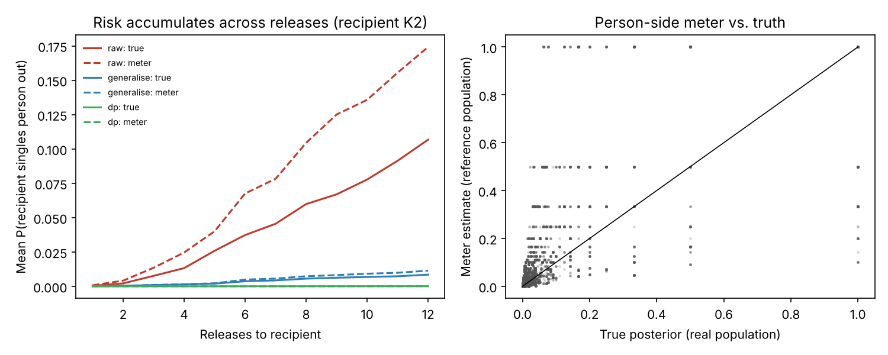

<!-- SPDX-License-Identifier: Apache-2.0 -->
# twinleak

**A per-person disclosure meter for digital health twin outputs.**

A digital health twin keeps talking to the outside world: reminders, summaries and figures go to apps, insurers, researchers and family. Each message on its own looks harmless. Together they can single a person out.

`twinleak` asks a question from the person's side: *after everything my twin has sent to this recipient, how likely is it that the recipient can tell which person I am?* The meter runs with the person's own data and a **public synthetic reference population**. It never needs the real population.

Everything here uses **synthetic data only**. There are no real people or records.

## Run it

```bash
make reproduce          # installs pinned deps, rebuilds every number and figure (~20 s on a laptop CPU)
make quick              # smoke test, ~2 s
```

The outputs go to `results/`: `summary.md`, `summary.json`, `points.json` and `risk.png`.

## What it does

1. **Population.** `population.py` generates 20,000 synthetic people with age, sex, region, conditions, medications and lab values. A second draw from the same generator is the public reference population.
2. **Twin releases.** `releases.py` writes 12 free-text messages per person to one recipient, under three modes: `raw`, `generalise` (coarsened quasi-identifiers) and `dp` (k-ary randomised response, ε = 1 per mention).
3. **Claim extraction.** `claims.py` turns each message into atomic claims. This is a rule-based baseline; the funded project adds LLM extraction.
4. **Recipient.** `risk.py` models three levels of prior knowledge: K1 is a public register (sex, region, age decade); K2 adds medication lists; K3 adds diagnoses. The recipient forms a posterior over everyone.
5. **Meter.** The person's estimate is `L_self / (L_self + (N−1)·mean_ref(L))`. It is compared with the true posterior after every release.

## Baseline results (seed 7, 300 targets, 32,400 person-release points)

| Mode | Recipient | Mean true risk after 12 releases | Singled out (>0.5) | Meter MAE | Meter within 0.10 |
| --- | --- | --- | --- | --- | --- |
| raw | K1 | 0.013 | 0.0% | 0.014 | 98.3% |
| raw | K2 | 0.107 | 5.0% | 0.052 | 88.3% |
| raw | K3 | 0.142 | 8.0% | 0.063 | 85.8% |
| generalise | K3 | 0.029 | 0.7% | 0.007 | 98.2% |
| dp | K3 | 0.000 | 0.0% | 0.000 | 100.0% |

Overall, the meter is within 0.10 of the true risk at 96.7% of points. **But the meter misses where it matters most:** among points where the person is truly singled out (posterior > 0.5), it raises the alarm only 69% of the time. It is also optimistic in one way: the reference population here comes from the same generator as the real one. Closing both gaps is the research project.



## Limitations

- The data are synthetic and come from a simple generator, with template text.
- Claim extraction is rule-based. Real twin text needs LLM extraction, and its errors must be measured.
- The randomised-response likelihood for multi-valued attributes is approximate.
- The meter estimates linkage risk. It does not yet measure what the recipient learns about lab values after linkage.

## Licence

Code: Apache-2.0 (SPDX tags in every file). Generated data: CC0 1.0.
